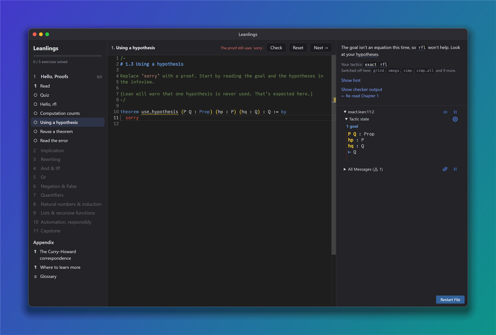

# Leanlings

> **DISCLAIMER:** This is an entirely vibecoded project. No code was read, all
> curriculum was generated and audited by an AI with no human expert in the
> loop. Use at your own risk.



A [Rustlings](https://github.com/rust-lang/rustlings)-style desktop app for
learning to prove theorems in [Lean 4](https://lean-lang.org/), from zero.
Each chapter has a friendly explainer with clickable glossary terms, a short
quiz, and small exercises where you replace `sorry` with a proof. Lean checks
your work live in an embedded editor with a goal view (the "infoview").

**Status:** proof of concept. Chapter 1 ("Hello, Proofs"), two appendix
articles and the glossary are written; chapters 2–11 are planned. See
[docs/curriculum/CURRICULUM.md](docs/curriculum/CURRICULUM.md).

## Features

- **Editor:** Monaco with the Lean language server and the official Lean
  infoview, via [lean4monaco](https://github.com/hhu-adam/lean4monaco).
- **Chapters:** Markdown prose with glossary popovers and syntax-highlighted
  Lean examples, an optional quiz, and exercises that fade from guided to blank.
- **Checking:** an exercise is solved when it compiles with no `sorry`, the
  theorem statement is unchanged, and only standard axioms are used.
  Automation that would skip the lesson (e.g. `grind`, `simp`, `decide`) is
  switched off per chapter.
- **Glossary** of every term, labelled with the chapter that introduces it.
- **Core Lean only:** no Mathlib, so the app stays small and starts quickly.

## Requirements

- [Node.js](https://nodejs.org/) (LTS)
- [Rust](https://rustup.rs/) and the [Tauri prerequisites](https://tauri.app/start/prerequisites/)
- [elan](https://github.com/leanprover/elan) (installs Lean; the exercises
  pin Lean 4.35.0 in `exercises/lean-toolchain`)

## Running

```bash
npm install
npm run tauri dev
```

## Writing curriculum

- Plan, content formats and markup: [docs/curriculum/CURRICULUM.md](docs/curriculum/CURRICULUM.md)
- Verified notes on core Lean, pedagogy and prior art: [docs/curriculum/research/](docs/curriculum/research/)
- Authoring workflow for Claude Code: the `curriculum` skill in
  [.claude/skills/curriculum/SKILL.md](.claude/skills/curriculum/SKILL.md)

Check all content (structure, every Lean snippet, every exercise starter and
reference solution) with:

```bash
npm run verify:curriculum
```

## Layout

```
src/                  React frontend (reader, glossary, quiz, editor)
src-tauri/            Rust backend (Lean server bridge, checker, verifier)
exercises/            Content shipped with the app: info.toml, glossary.toml,
                      Chapters/, Appendix/, Exercises/ (a Lake project)
curriculum/solutions/ Reference solutions (not shipped)
docs/curriculum/      Curriculum plan and research notes
```
